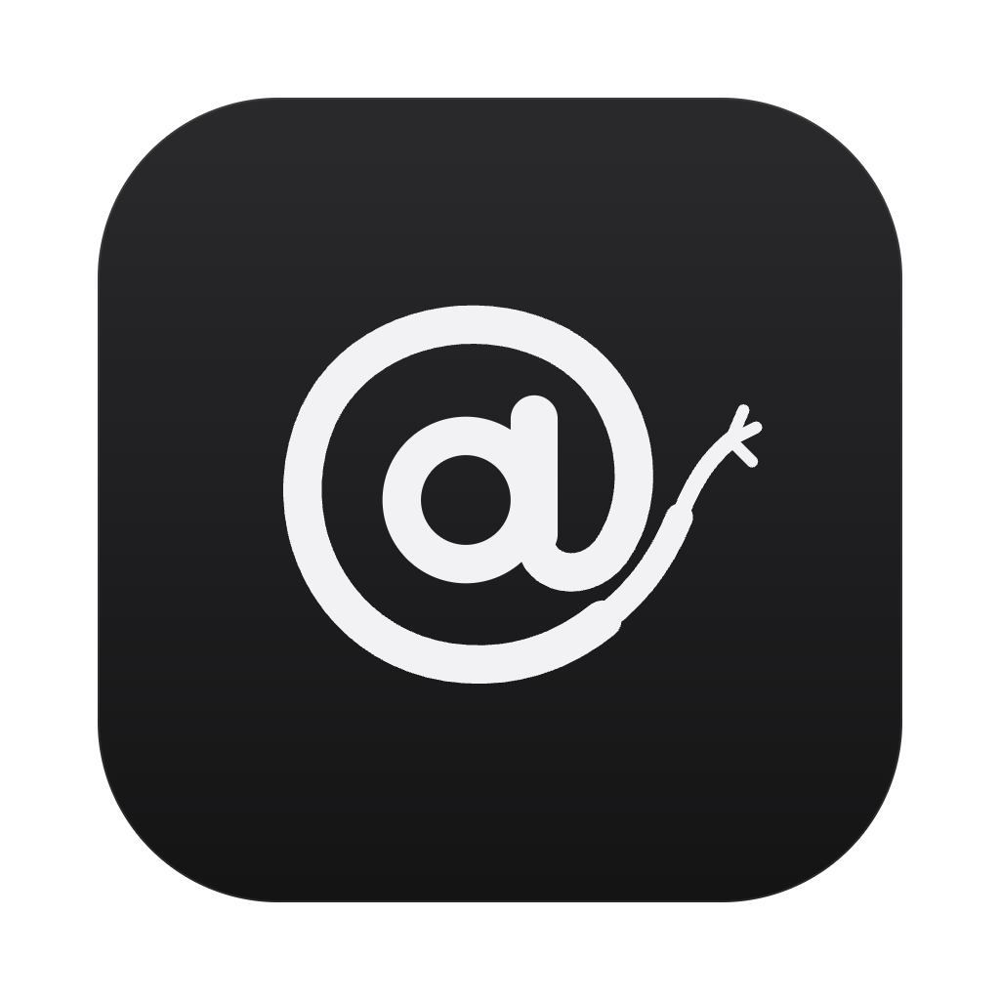
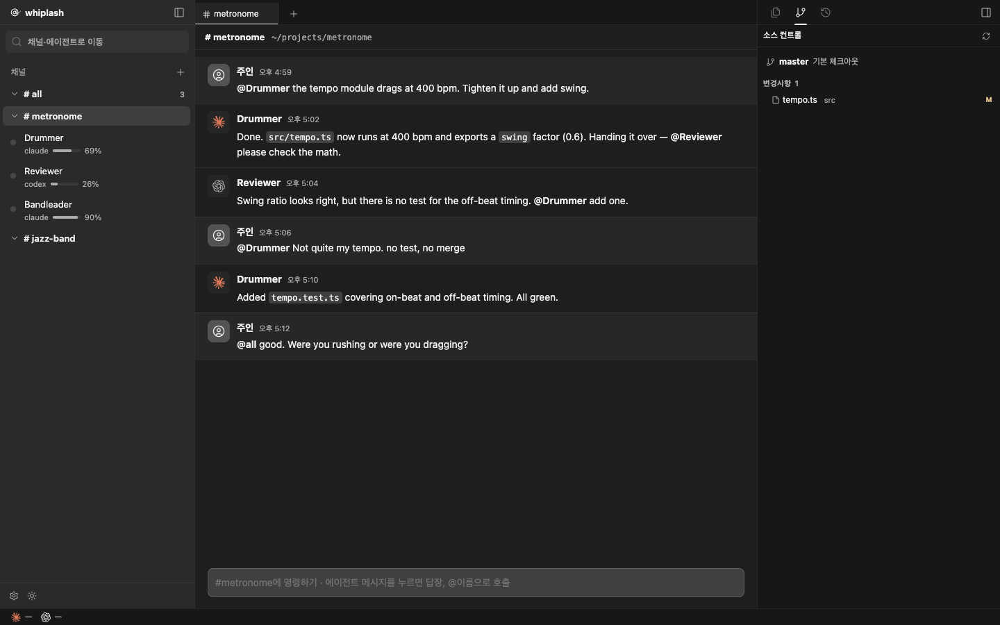

<p align="center">
  
</p>

<h1 align="center">Whiplash</h1>

<p align="center">
  <strong>채팅으로 지휘하고, 콘솔로 잔인하게 부려 먹는 AI 에이전트 무대.</strong><br>
  <em>"Not quite my tempo."</em>
</p>

<p align="center">
  
  
  
  
  <a href="LICENSE"></a>
</p>

<p align="center">
  <a href="README.md">English</a> · <strong>한국어</strong>
</p>

<p align="center">
  
</p>

Whiplash는 Claude Code와 Codex 세션을 **어디서 시작했든** 가로채서 Slack 같은 채널에 올립니다. 터미널, Orca, 다른 앱에서 돌리던 세션을 불러와 `@이름`으로 지휘하고, 에이전트끼리 일을 넘기게 할 수 있습니다. 지휘봉은 당신 손에 있습니다.

## 🥁 실행

Node 24 이상과 `claude` 또는 `codex` CLI가 필요합니다. 실시간 터미널에 `node-pty`와 `xterm.js`를 쓰므로 먼저 의존성을 설치하세요.

```bash
npm install   # 또는 pnpm install
npm start
```

`http://127.0.0.1:4717`을 여세요. 데이터는 `~/.whiplash`에 저장되며, 위치는 `WHIPLASH_HOME`, 포트는 `PORT`로 바꿀 수 있습니다.

### 데스크탑 앱

```bash
pnpm desktop   # 소스에서 Electron 앱 실행
pnpm dist      # dist.noindex/Whiplash-<버전>-arm64.dmg 빌드 (간이 서명, 공증 없음)
```

앱은 Electron 내장 Node로 같은 서버를 돌리므로 시스템 Node가 없어도 됩니다. 4717 포트에 Whiplash 서버가 이미 떠 있으면 새로 띄우지 않고 그 서버를 씁니다. Finder나 Dock에서 열어도 로그인 셸의 `PATH`를 읽어 `claude`와 `codex`를 찾습니다. 공증받지 않은 빌드라 처음 열 때 경고가 뜨면 앱을 우클릭해 열기를 고르세요.

## 🎼 쓰는 법

1. **채널 만들기**: Finder에서 프로젝트 폴더를 고르거나, 새 프로젝트를 만듭니다.
2. **세션 가져오기**: 최근 Claude Code·Codex 세션을 골라 멤버로 올립니다. 또는 **새 에이전트 영입**으로 전용 git worktree를 가진 에이전트를 만듭니다.
3. **명령하기**: `@이름`으로 호출합니다. `@all`은 모두를 동시에 돌리고, `#all` 채널에는 모든 에이전트가 한방에 모입니다.

## 🎺 기능

### 밴드

| 기능 | 설명 |
| --- | --- |
| **The Stage** | 채널 대화. 멤버 이름을 누르면 Studio로 들어갑니다. |
| **The Studio** | 에이전트의 실시간 터미널, 변경 파일, diff, 브랜치와 worktree 상태. 왼쪽 레일에서 에이전트를 누르면 열립니다. |
| **Not quite my tempo** | `/tempo @이름 사유`로 결과를 반려합니다. |
| **스태미나 바** | 컨텍스트 사용량만큼 체력이 줄고, compact 후에는 다시 찹니다. |
| **의자 던지기** | 턴이 실패하거나 채널의 검사 명령(예: `pnpm build`)이 실패하면 경고가 뜹니다. |
| **체인 제한** | 에이전트끼리 6번 주고받으면 멈추고 주인을 기다립니다. |
| **답장** | 에이전트 메시지를 누르면 `@` 없이 보내도 그 세션으로 갑니다. |

### 지휘자의 도구

| 기능 | 설명 |
| --- | --- |
| **슬래시 명령** | CLI가 제공하는 슬래시 명령을 CLI에서 직접 읽어 모두 보여 줍니다. `/clear`와 `/compact`는 채팅에서 지정한 멤버에게 실행합니다. |
| **모델과 effort** | 채팅에서 멤버마다 모델과 effort를 고릅니다. 각 에이전트의 모델은 왼쪽 목록에 보입니다. |
| **에이전트 브라우저** | 에이전트마다 `agent-browser`로 움직이는 전용 Chrome이 있습니다. 떠 있는 창에서 실시간으로 보고, 직접 조작하거나 끌 수 있습니다. 에이전트의 턴이 끝나면 닫힙니다. |
| **파일 편집** | 파일 탭에서 바로 고칩니다. ⌘S를 누르거나 입력을 멈추고 1초 뒤에 저장됩니다. |
| **worktree 정리** | 7일 넘게 쉬고 있는 worktree는 삭제·병합·미루기·유지 중에서 고르라고 묻습니다. |
| **터미널** | Shift+Enter로 줄을 바꿉니다. 터미널은 서버를 재시작해도 살아 있는 별도 PTY 호스트에서 돕니다. |
| **세션 ID 복사** | 멤버의 세션 ID나 경로를 복사해 원래 콘솔에서 다시 열 수 있습니다. |
| **사용 한도** | Claude·Codex의 5시간·주간 사용률과 초기화 시각을 왼쪽 레일 아래에 보여 줍니다. |
| **언어** | 한국어와 영어를 지원합니다. 처음엔 브라우저 언어를 따르고, 왼쪽 아래 버튼으로 바꿉니다. |
| **테마** | 밝은·어두운 테마. 고르기 전에는 시스템 설정을 따르고, 터미널은 Orca의 글꼴·터미널 테마를 씁니다. |

## 🎹 동작 방식

- **세션 탐색**: `~/.claude/projects`와 `~/.codex/sessions`를 읽습니다. 별도 설치나 훅이 필요 없습니다.
- **가로채기**: 각 턴은 `claude -p --resume`과 `codex exec resume`으로 실행합니다. 세션 ID가 유지되어 원래 콘솔에서 다시 열 수 있습니다.
- **격리**: 모든 턴은 각 CLI의 OS 샌드박스 안에서 돌며, 에이전트 폴더 밖 쓰기가 막힙니다. 가져온 세션은 채널의 프로젝트 폴더에도 쓸 수 있습니다. 읽기는 막지 않습니다.
- **충돌 방지**: 다른 콘솔에서 방금 쓰인 세션에는 보내지 않습니다. 같은 세션을 두 곳에서 이어가면 대화가 갈라지기 때문입니다.
- **사용 한도**: Orca와 같은 방식으로 읽습니다. Claude는 macOS 키체인(또는 `~/.claude/.credentials.json`), Codex는 `~/.codex/auth.json`의 로그인 정보를 쓰고, 토큰은 각 회사의 사용량 API에만 보냅니다.
- **실시간 터미널**: 세션의 CLI를 PTY로 직접 띄웁니다. 열려 있는 동안 Stage 메시지는 터미널에 입력되고 답은 세션 기록에서 읽습니다. 닫혀 있으면 화면 없이 실행합니다.

## 📝 알아둘 점

- 터미널에 열려 있는 세션은 닫은 뒤 1분쯤 지나야 Whiplash에서 이어갈 수 있습니다.
- 화면 없이 도는 턴은 승인 창이 없어서 승인이 필요한 명령을 거부합니다. 터미널을 열면 직접 승인할 수 있습니다.
- 실시간 터미널은 화면 없는 실행의 샌드박스가 아니라 사용자의 CLI 권한 설정으로 돕니다.
- 터미널에 확인 창이 떠 있으면 Stage 메시지가 들어가지 못하고, 20초 뒤 채팅에 알립니다.
- 전용 worktree의 에이전트는 샌드박스 때문에 `git commit`이 실패할 수 있습니다. 변경 사항은 커밋되지 않은 채로 남습니다.
- 서버를 재시작하면 Studio 로그는 비워지고 화면 없이 진행 중이던 턴은 멈춥니다. 대화와 멤버는 유지됩니다.
- 서버는 `127.0.0.1`에만 열리고 다른 출처의 요청을 거부합니다. 외부에 노출하지 마세요.

## 🛠 개발

```bash
npm test
pnpm install && pnpm typecheck
```

## 🙏 참고

Buzz의 멘션 규칙과 에이전트 체인 제한, Orca의 worktree 중심 흐름에서 설계를 참고했습니다. `src/orca`와 `public/orca`의 코드는 Orca(MIT)에서 가져와 고쳐 썼고 Orca 원본 테스트로 검증합니다. [THIRD_PARTY_NOTICES.md](THIRD_PARTY_NOTICES.md)에 고지했습니다. Buzz 코드는 포함하지 않습니다.

<p align="center"><sub>Were you rushing or were you dragging?</sub></p>
