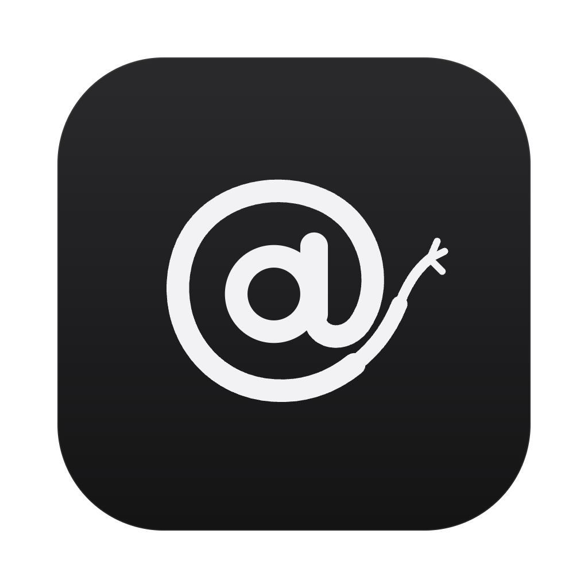
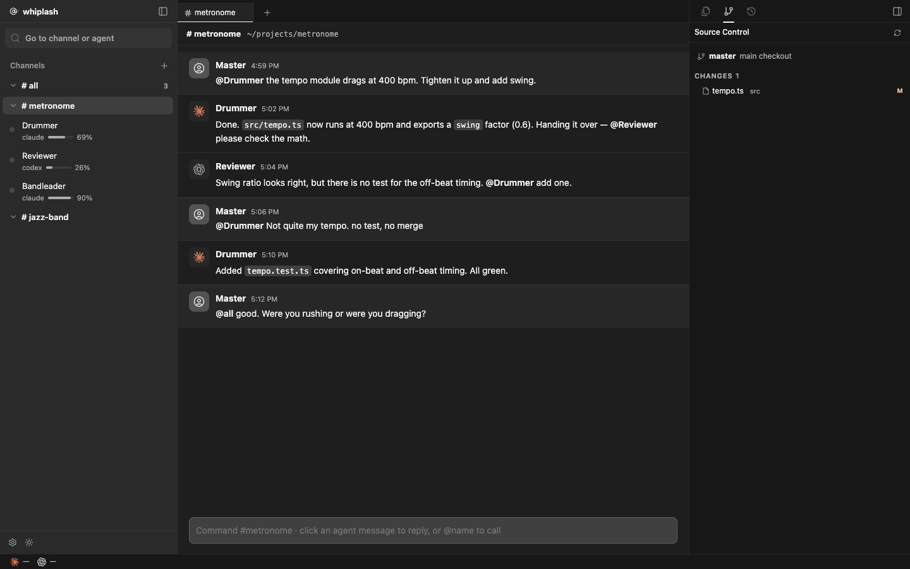

<p align="center">
  
</p>

<h1 align="center">Whiplash</h1>

<p align="center">
  <strong>Conduct your AI agents from a chat room, and drive them hard from the console.</strong><br>
  <em>"Not quite my tempo."</em>
</p>

<p align="center">
  
  
  
  
  <a href="LICENSE"></a>
</p>

<p align="center">
  <strong>English</strong> · <a href="README.ko.md">한국어</a>
</p>

<p align="center">
  
</p>

Whiplash takes over Claude Code and Codex sessions **wherever they started** and puts them in Slack-style channels. Bring in sessions from a terminal, from Orca or from any other tool, call them with `@name`, and let agents hand work to each other. You hold the baton.

## 🥁 Run

You need Node 24 or later and the `claude` or `codex` CLI. The live terminal uses `node-pty` and `xterm.js`, so install dependencies first.

```bash
npm install   # or pnpm install
npm start
```

Open `http://127.0.0.1:4717`. Data lives in `~/.whiplash`; set `WHIPLASH_HOME` to move it and `PORT` to change the port.

### Desktop app

```bash
pnpm desktop   # run the Electron app from source
pnpm dist      # build dist.noindex/Whiplash-<version>-arm64.dmg (ad-hoc signed, not notarized)
```

The app runs the same server on Electron's own Node, so it needs no system Node. If a Whiplash server is already on port 4717 the app uses it instead of starting a second one. Launched from Finder or the Dock, it reads `PATH` from your login shell so `claude` and `codex` are found. The build is not notarized: if macOS warns on first open, right-click the app and choose Open.

## 🎼 Use

1. **Create a channel**: pick a project folder in Finder, or create a new project for it.
2. **Import a session** to add a recent Claude Code or Codex session as a member, or **hire a new agent** that works in its own git worktree.
3. **Command**: call members with `@name`. `@all` runs every member at once, and the `#all` channel seats every agent in one room.

## 🎺 Features

### The band

| Feature | What it does |
| --- | --- |
| **The Stage** | The channel conversation. Click a member to open their Studio. |
| **The Studio** | The agent's live terminal, changed files, diffs, and branch and worktree state. Click an agent in the left rail to open it. |
| **Not quite my tempo** | Reject a result with `/tempo @name reason`. |
| **Stamina bar** | Drains as the agent's context fills up, and refills after a compact. |
| **Throw the chair** | An alert when a turn fails or the channel's check command (for example `pnpm build`) fails. |
| **Chain limit** | Agents stop after passing work back and forth 6 times and wait for the master. |
| **Reply** | Click an agent's message, and messages without `@` go to that session. |

### The conductor's tools

| Feature | What it does |
| --- | --- |
| **Slash commands** | Every slash command the CLI offers, read from the CLI itself. `/clear` and `/compact` run on named members from the chat. |
| **Model and effort** | Pick each member's model and effort from the chat; each agent's model shows in the left list. |
| **Agent browser** | Each agent gets its own Chrome, driven by `agent-browser`. Watch it live in a floating window, take control, or turn it off. It closes when the agent's turn ends. |
| **File editing** | Edit files right in their tab. Saved on ⌘S, and a second after you stop typing. |
| **Worktree cleanup** | Worktrees idle for 7+ days get a question: delete, merge, snooze or keep. |
| **Terminal** | Shift+Enter inserts a newline. Terminals live in a separate PTY host that survives server restarts. |
| **Copy session ID** | Copy a member's session ID or paths, to reopen the session in its original console. |
| **Plan limits** | Claude and Codex 5-hour and weekly usage with reset times, at the bottom of the left rail. |
| **Languages** | English and Korean. The browser language is the default; switch with the button at the bottom left. |
| **Themes** | Light and dark, following the system until you pick one. The terminal uses your Orca font and terminal themes. |

## 🎹 How it works

- **Discovery** reads `~/.claude/projects` and `~/.codex/sessions`. Nothing needs to be installed or hooked.
- **Takeover** runs each turn with `claude -p --resume` or `codex exec resume`. The session id stays the same, so you can reopen it in its original console.
- **Isolation** runs every turn inside each CLI's OS sandbox, so writes outside the agent's folders are refused. An imported session may also write to the channel's project folder. Reads are not blocked.
- **Collision guard** refuses to send to a session another console just wrote, because continuing one session from two places splits the conversation.
- **Plan limits** are read the way Orca reads them: the Claude login from the macOS keychain (or `~/.claude/.credentials.json`) and the Codex login from `~/.codex/auth.json`. The tokens are only sent to each provider's own usage endpoint.
- **Live terminal** runs the session's own CLI in a PTY. While it is open, Stage messages are typed into it and the reply is read from the session transcript; when it is closed, turns run headless.

## 📝 Good to know

- A session that is open in a terminal can be continued in Whiplash about a minute after you close it there.
- Headless turns refuse commands that need approval, because they have no prompt to ask. Open the terminal to approve them yourself.
- The live terminal runs with your own CLI permission settings, not the headless sandbox.
- If the terminal is showing a dialog, a Stage message cannot get in; Whiplash says so after 20 seconds.
- Agents in their own worktree may fail to `git commit` because of the sandbox. Their changes stay uncommitted.
- Restarting the server clears Studio logs and stops running headless turns. Channels and conversations are kept.
- The server listens only on `127.0.0.1` and refuses requests from other origins. Do not expose it.

## 🛠 Develop

```bash
npm test
pnpm install && pnpm typecheck
```

## 🙏 Credits

The design borrows Buzz's mention rules and agent chain limit, and Orca's worktree-first flow. Code under `src/orca` and `public/orca` is adapted from Orca (MIT) and runs Orca's own tests; see [THIRD_PARTY_NOTICES.md](THIRD_PARTY_NOTICES.md). No Buzz code is included.

<p align="center"><sub>Were you rushing or were you dragging?</sub></p>
